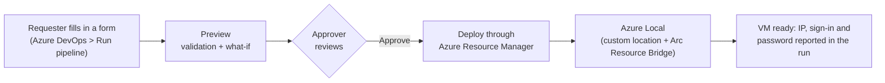

# Azure Local Self-Service with Azure DevOps

> **Note:** IDs, names and domains in this repo (subscription, custom location, Key Vault, `contoso.com`, `your-ado-org`) are placeholders. Set your own in `pipelines/vars/azlocal.yml` and `params/*.bicepparam`, then run `scripts/Initialize-AzureLocalDevOps.ps1`.

Give your team a form for every common Azure Local request - a Windows or Linux VM, a logical network, a
network security group, Azure Virtual Desktop session hosts, an AKS cluster - and let Azure DevOps build it.
Every request is previewed, approved and recorded, and nobody needs access to the cluster nodes.



## What you get

| | |
|---|---|
| **Self-service forms** | Six pipelines with drop-downs filled from your own cluster: New VM, New Logical Network, New NSG, New AVD Hosts, New AKS Cluster, plus Sync Dropdowns that keeps the choices current. |
| **Windows and Linux** | The VM's operating system follows the image you pick. Windows VMs can join your domain; Linux VMs get password and SSH-key sign-in. |
| **Ready-to-use VMs** | Remote access turned on (RDP or SSH), IPv6 turned off if you want, optional Azure Arc SSH so you can connect without any network path to the VM. |
| **Guardrails** | Every change is previewed first and waits for an approver. Bad input (taken names, reserved words, a full IP pool, a Linux image for AVD) is rejected before anything is built. |
| **No stored secrets** | Pipelines sign in to Azure with federated identities - no passwords or keys in Azure DevOps. Each VM gets its own local admin password, kept in Azure Key Vault. |
| **Infrastructure as code** | Everything is Bicep in Git. VMs you want to keep in code can be added through a pull request instead of a form. |

## How it works

Azure DevOps never connects to your cluster. Each pipeline runs on a Microsoft-hosted agent and submits a
deployment to Azure Resource Manager; Azure Local's Arc Resource Bridge carries it out on the cluster. Inside
each new VM, the Azure Arc agent applies the finishing steps (remote access, IPv6, domain join, SSH).

| Component | Purpose |
|---|---|
| Two managed identities | One for networks and AKS, one for VMs and AVD, each with only the Azure roles it needs |
| Azure DevOps service connections | Link the pipelines to those identities using workload identity federation |
| Azure Key Vault | Holds the domain-join password and every VM's local admin password |
| `azlocal-prod` environment | The approval gate in front of every change |
| Git repository | Bicep templates, pipeline definitions and setup scripts |

## Before you start

**Azure Local**
- An Azure Local instance deployed and registered, with its Arc Resource Bridge showing **Running**.
- At least one VM image on the cluster (Windows and/or Linux, for example from Azure Marketplace).
- A logical network for VMs, or plan to create one with the New Logical Network form.
- For network security groups: SDN enabled by Azure Arc on the cluster.

**Azure and identity**
- Owner (or Contributor + User Access Administrator) on the subscription or resource group.
- For domain join: an Active Directory OU for the new VMs and an account allowed to join computers to it.
- For AKS: a Microsoft Entra group whose members will administer the clusters.
- For AVD: a Windows 11 multi-session (or Windows Server) image on the cluster.

**Azure DevOps and tools**
- An Azure DevOps organization, ideally connected to your Microsoft Entra tenant.
- A personal access token (PAT) with Full access, used only during setup.
- On the machine you run setup from: PowerShell 7, Azure CLI 2.60 or later, and Git.

## Setup

Allow about an hour. Steps 1-4 happen on your workstation; the scripts do the Azure and Azure DevOps work.

### 1. Get the code

```powershell
git clone https://github.com/jaycalderwood/Azure-Local-Deployment.git C:\Repos\azure-local-devops
cd C:\Repos\azure-local-devops
Get-ChildItem -Recurse -Filter *.ps1 | Unblock-File
Set-ExecutionPolicy -Scope Process -ExecutionPolicy Bypass -Force
```

### 2. Enter your environment's values

All shared settings live in **`pipelines/vars/azlocal.yml`**. Replace the placeholder values:

| Setting | What to enter | Example |
|---|---|---|
| `AZL_RG` | Resource group that holds your Azure Local instance | `rg-azurelocal` |
| `AZL_LOCATION` | Azure region the instance is registered in | `eastus` |
| `AZL_CUSTOM_LOCATION_ID` | Full resource ID of the instance's custom location | `/subscriptions/.../customLocations/my-site` |
| `AZL_KEYVAULT` | Key Vault the setup script creates: `kv-azl-` + first 8 characters of your subscription ID (no dashes) | `kv-azl-1a2b3c4d` |
| `AZL_STORAGE_PATH` | Storage path name for VM files | `UserStorage1-...` |
| `AZL_VM_SWITCH` | Hyper-V switch for new logical networks (`Get-VMSwitch` on a node) | `ConvergedSwitch(compute_management)` |
| `AZL_ADMIN_USER` | Local admin user created on every VM | `azladmin` |
| `AZL_DOMAIN` / `AZL_DOMAIN_OU` | Domain to join and the OU for new computer accounts | `contoso.com` / `OU=AzureLocal,DC=contoso,DC=com` |
| `AZL_DOMAIN_JOIN_USER` | Account allowed to join computers (no domain prefix) | `svc-domainjoin` |
| `AZL_DNS` | DNS server(s) for new VMs - your domain controllers | `10.0.0.10` |
| `AZL_MGMT_CIDR` | Network your admins connect from (used by NSG presets) | `10.0.0.0/24` |

To list the custom location, storage paths, networks and images in your resource group:

```powershell
az login
./scripts/Get-AzLocalIds.ps1 -SubscriptionId <subscription-id> -ClusterResourceGroup <resource-group>
```

The drop-down lists in the forms are filled in automatically from your cluster later (step 6), so you don't
need to edit them.

### 3. Prepare Active Directory (only if VMs should join a domain)

On a domain controller:

```powershell
New-ADOrganizationalUnit -Name "AzureLocal" -Path "DC=contoso,DC=com"
New-ADUser -Name svc-domainjoin -SamAccountName svc-domainjoin -Path "CN=Users,DC=contoso,DC=com" `
  -AccountPassword (Read-Host -AsSecureString "Password") -Enabled $true -PasswordNeverExpires $true
$ou = "OU=AzureLocal,DC=contoso,DC=com"
dsacls $ou /G "CONTOSO\svc-domainjoin:CC;computer"
dsacls $ou /I:S /G "CONTOSO\svc-domainjoin:RPWP;;computer" "CONTOSO\svc-domainjoin:CA;Reset Password;computer" `
  "CONTOSO\svc-domainjoin:WS;Validated write to DNS host name;computer" "CONTOSO\svc-domainjoin:WS;Validated write to service principal name;computer"
```

### 4. Run the setup script

```powershell
az login
$pat = Read-Host "Azure DevOps PAT" -MaskInput
./scripts/Initialize-AzureLocalDevOps.ps1 -SubscriptionId <subscription-id> `
    -ClusterResourceGroup <resource-group> -AdoOrganization <devops-org> -AdoPat $pat
```

It creates the identities and their roles, the Key Vault, the Azure DevOps project and repository (and pushes
this code to it), the service connections, the secrets variable group, the `azlocal-prod` environment with
you as approver, the Git-path pipelines and a pull-request policy. When asked, enter the domain-join
account's password (or press Enter to set it later). It's safe to run again.

### 5. Add the self-service forms

```powershell
./scripts/Add-AzureLocalPipelines.ps1 -SubscriptionId <subscription-id> -ResourceGroup <resource-group> `
    -KeyVaultName <kv-azl-xxxxxxxx> -AdoOrganization <devops-org> -AdoPat $pat
```

This registers the six form pipelines, authorizes them, grants the extra Azure roles AVD and AKS need, and
lets Sync Dropdowns save its updates.

### 6. Finish in Azure DevOps

1. **Pipelines > Sync Dropdowns > Run pipeline** - fills every form's drop-downs from your cluster.
2. **Pipelines > Environments > azlocal-prod > Approvals and checks** - add the people who approve changes.
3. **Revoke the PAT** (User settings > Personal access tokens). Nothing ongoing uses it.
4. Run **New VM** once as a test (see below).

If the domain-join password wasn't set in step 4:
`az keyvault secret set --vault-name <kv-azl-xxxxxxxx> -n domainJoinPassword --value '<password>'`

## Using the forms

Go to **Pipelines**, choose a form, select **Run pipeline**, fill it in and select **Run**. The **Preview**
stage checks the request and shows exactly what will be created. An approver then reviews it and the
**Deploy** stage builds it.

| Form | Creates |
|---|---|
| **New VM** | A Windows or Linux VM: image, size, data disk, network, IP (automatic or fixed), optional NSG, domain join, remote access, IPv6, SSH key, Azure Arc SSH |
| **New Logical Network** | A network VMs attach to: static IP pool or DHCP, VLAN, DNS, optional NSG |
| **New NSG** | A network security group from a preset (below), optionally applied to a whole network |
| **New AVD Hosts** | Azure Virtual Desktop host pool, app group and workspace (if new) plus session hosts that join the domain and register |
| **New AKS Cluster** | An AKS cluster enabled by Azure Arc on a static logical network |
| **Sync Dropdowns** | Refreshes the forms' network, NSG, image and host-pool lists (also runs every 6 hours) |

### Your VM's details and password

When a New VM or New AVD Hosts run finishes, its results are in two places:

- a summary block at the **end of the Deploy step's log**, and
- the run's **Extensions** tab, under the VM's name.

You'll see the IP address, the admin user, how to connect, and either the password itself (if you ticked
**Show the local admin password**) or the Key Vault secret that holds it. These are reported even if a late
step such as the domain join fails, so you can always sign in and investigate. To fetch a password later:

```powershell
az keyvault secret show --vault-name <kv-azl-xxxxxxxx> -n vm-<vm-name>-admin --query value -o tsv | Set-Clipboard
```

### Windows and Linux

| | Windows | Linux |
|---|---|---|
| Name length | up to 15 characters | up to 54 characters |
| Sign in | admin user + password, Remote Desktop | admin user + password, plus your SSH key if provided |
| Remote access option | Remote Desktop and ping enabled | SSH enabled |
| Turn off IPv6 option | Yes | Yes |
| Domain join | Yes | Not available (skipped with a warning) |
| Azure Arc SSH option | Installs *OpenSSH for Windows - Azure Arc* | Uses the built-in SSH service |
| Azure Virtual Desktop | Yes | No |

To offer a new image in the forms, add it to your Azure Local instance (Azure portal > your instance > VM
images > Add VM image), then run **Sync Dropdowns**.

### Connecting through Azure Arc (no network path needed)

Tick **Install the Azure Arc SSH extension** on the New VM form, then connect from anywhere you can sign in
to Azure:

```powershell
az extension add --upgrade --name ssh
az ssh arc --resource-group <resource-group> --name <vm-name> --local-user azladmin
az ssh arc --resource-group <resource-group> --name <vm-name> --local-user azladmin --rdp   # Windows: Remote Desktop over SSH
```

The first connection may ask you to allow port 22 as the Azure Arc endpoint. You need the Azure Stack HCI
Administrator role (or higher) on the resource group.

### Network security group presets

| Preset | Allows in | Good for |
|---|---|---|
| Windows-Server-Baseline | Remote Desktop, ping and WinRM from your admin network | Windows servers |
| Web-Server | The baseline plus HTTP and HTTPS from anywhere | Web servers |
| Domain-Controller | The baseline plus DNS, Kerberos, LDAP, SMB/RPC, NTP | Domain controllers |
| Allow-Subnet-Only | Everything from your admin network | Linux servers (includes SSH) |
| Deny-All-Inbound | Nothing | Outbound-only workloads |

Every preset blocks all other inbound traffic and allows outbound. Applying an NSG to a whole network affects
every VM already on it, so the form asks you to confirm.

### Keeping VMs in code (optional)

List VMs in `params/vms.bicepparam` and merge the change through a pull request. The pull request shows a
preview; merging deploys after approval.

```bicep
param vms = [
  { name: 'APP01', processors: 4, memoryMB: 8192, disableIPv6: true, dataDisksGB: [ 64 ] }
  { name: 'web-linux-01', osType: 'Linux', image: '<linux-image>', sshPublicKey: 'ssh-ed25519 AAAA...', domainJoin: false, sshExtension: true }
]
```

## Security

| Identity | Used by | Azure roles |
|---|---|---|
| `id-azlocal-infra` | New Logical Network, New NSG, New AKS Cluster | Azure Stack HCI Administrator, Contributor (resource group), Key Vault Secrets Officer |
| `id-azlocal-vms` | New VM, New AVD Hosts, Sync Dropdowns | Azure Stack HCI VM Contributor, Desktop Virtualization Contributor, Key Vault Secrets Officer |

- Pipelines authenticate with workload identity federation; there are no client secrets to rotate.
- Every change waits for approval on the `azlocal-prod` environment.
- Each VM has its own randomly generated local admin password in Key Vault.
- Showing a password in run results is opt-in per request; anyone who can view that run can then read it.

## Rules worth knowing

- **Names:** Azure rejects names containing `microsoft` or `windows`, starting with `login` or `xbox`, or
  equal to words such as `azure` or `office`. The forms check this for you.
- **Network settings are fixed once a VM exists.** IP address, DNS, network and NSG on a VM's network adapter
  can't be changed afterwards; CPU, memory and disks can. Recreate the VM to change them.
- **Logical networks can't be edited in place.** Create a new one instead.
- **Removing** a VM from `params/vms.bicepparam` does not delete it. Delete with
  `az stack-hci-vm delete --resource-group <resource-group> --name <vm-name> --yes`.
- A new VM typically takes 20-30 minutes; the first VM from a new image takes longer.

## Troubleshooting

| What you see | Likely cause | What to do |
|---|---|---|
| Deploy waits a long time at the extensions step | The Azure Arc agent inside the VM hasn't connected | `az stack-hci-vm show --name <vm> -g <rg> --query properties.instanceView.vmAgent`; if it shows Connected, run `az stack-hci-vm update --name <vm> -g <rg> --enable-agent true` |
| Domain join failed | Wrong join password, missing OU rights, or the computer name already exists | Check the error on the VM's `joindomain` extension; fix the password in Key Vault or the OU rights |
| `ReservedResourceName` | A reserved word in a name | Choose another name |
| `DNS Settings cannot be changed after resource creation` | Redeploying an existing VM with different network settings | Recreate the VM |
| Only **Bypass checks** appears, no **Approve** | You aren't listed as an approver | Add yourself under Approvals and checks on `azlocal-prod` |
| Sync Dropdowns can't push | The build service lacks repository rights | Re-run `Add-AzureLocalPipelines.ps1`, or allow *Contribute* and *Bypass policies when pushing* for the project's Build Service on the repository |
| A Linux VM won't boot | Unsigned image with Secure Boot on | Run New VM again with Secure Boot unticked |

## Repository layout

```
bicep/                 Bicep templates (VM, logical network, NSG, AVD) and modules
params/                Git-path definitions (vms.bicepparam, infra.bicepparam)
pipelines/             Form pipelines, Git-path pipelines and shared settings (vars/azlocal.yml)
scripts/               Setup scripts (PowerShell) and the scripts each form runs
```

## References

- [Create Azure Local VMs](https://learn.microsoft.com/en-us/azure/azure-local/manage/create-arc-virtual-machines)
- [Manage Azure Local VMs and guest management](https://learn.microsoft.com/en-us/azure/azure-local/manage/manage-arc-virtual-machines)
- [Connect to Azure Local VMs using SSH](https://learn.microsoft.com/en-us/azure/azure-local/manage/connect-arc-vm-using-ssh)
- [Prepare a Linux image for Azure Local](https://learn.microsoft.com/en-us/azure/azure-local/manage/virtual-machine-image-linux-sysprep)
- [Create AKS clusters on Azure Local](https://learn.microsoft.com/en-gb/azure/aks/hybrid/aks-create-clusters-cli)
